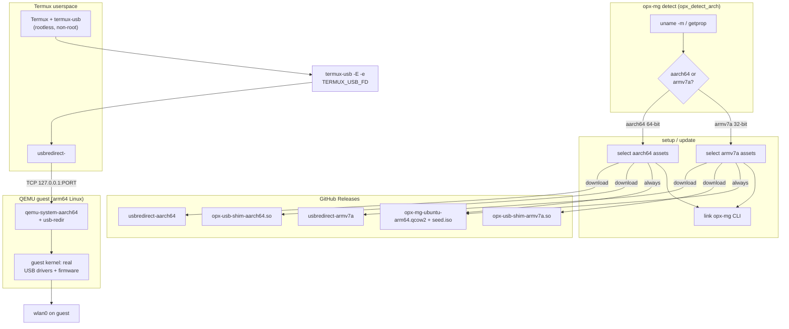

# opx-mg architecture

Rootless USB Wi-Fi on stock Android, inside Termux. No custom phone kernel.
No Magisk. No NetHunter flash. The phone kernel never sees the dongle as a
Wi-Fi NIC — Android only hands over a USB file descriptor.

## Flow

Host architecture is detected at `setup`/`update` time (not build time) from
the running Termux userspace, so the matching binaries are always chosen.



```
USB dongle
    |
Android UsbManager  (permission dialog once)
    |
termux-usb -E -e ...   SCM_RIGHTS fd  ->  TERMUX_USB_FD
    |
usbredirect --device /proc/self/fd/$TERMUX_USB_FD --as 127.0.0.1:PORT
    |                                     # PORT is per bus/device
TCP 127.0.0.1:PORT  (usbredir protocol)
    |
qemu-system-aarch64  -device qemu-xhci  -device usb-redir,chardev=...
    |
guest Linux kernel  (real USB stack, real drivers, real firmware)
    |
wlan0  ->  iw / aircrack / wifi4 / whatever the user wants
```

## Why this path

Three other rootless stacks exist. None of them is a Termux one-command.

| Stack | What it is | Why not opx-mg |
|---|---|---|
| Podroid / YourXDemon | Android app. `UsbManager.openDevice()` fd -> QMP `add-fd` SCM_RIGHTS -> `device_add usb-host,hostdevice=/dev/fdset/N`. Guest Alpine/Debian. | APK, not Termux. Needs a libusb-enabled QEMU built as an `.so`. Xiaomi `Invalid ep0 maxpacket: 64` needs a QEMU `host-libusb.c` quirk **and/or** a patched guest `hub.c`. |
| StrykerOSS | Rooted Debian chroot by default. Rootless fallback is the same QEMU usb-host fd path. UML engine in 6.5. | Root preferred. APK. Not Termux. |
| linux-um-arm64 | UML kernel as a userspace process. USB via USB/IP, not usb-host. Native speed. | Research kernel. USB/IP, not usbredir. No Termux installer. |
| proroot | LD_PRELOAD proot replacement. A USB FD compatibility layer was *proposed*, not shipped. Source is closed. | Userspace fake root. Cannot load a real USB Wi-Fi driver. |
| Kuldeep / termux#19635 | Manual Termux recipe: compile usbredir, `termux-usb -e usbredirect`, QEMU `-device usb-redir`. Proven with mass-storage and a scanner. | Many steps. No prebuilt guest. No hotplug. No Wi-Fi firmware image. |

opx-mg is the Kuldeep / termux#19635 path, packaged: one CLI, binaries from
this repo's releases, a guest image that already has Wi-Fi firmware and
out-of-tree Realtek/MediaTek modules, and a watcher that attaches a dongle
the moment `termux-usb -l` sees it.

QEMU source differs by host arch, because `termux-main` only builds it for
64-bit: aarch64 uses `qemu-system-aarch64-headless`, while armv7a uses TUR's
`qemu-system-aarch64-9` (QEMU 9 is the last series built for 32-bit hosts)
plus `qemu-common-10` for `edk2-aarch64-code.fd`. `setup` picks the right
set, so the installer stays one command on both arches.

## Components

```
opx-mg                 user-facing CLI (this repo, POSIX sh)
  bin/opx-mg           dispatcher
  lib/common.sh        paths, logging, download
  lib/setup.sh         first-run: pkg deps, QEMU per arch, release assets
  lib/vm.sh            start/stop QEMU, QMP helper
  lib/usb.sh           list / request / usbredirect / QMP hotplug
  lib/watch.sh         poll termux-usb -l, attach on connect
  lib/logs.sh          diagnostic log viewer + shareable bundle
  host/usbredirect     prebuilt aarch64/armv7a usbredir tool (release asset)
  host/opx-usb-shim.c  optional: wrap TERMUX_USB_FD as a libusb device
  guest/cloud-init/    seed ISO: firmware, modules, ssh, motd
  guest/build-image.sh how the release qcow2 is forged (CI / desktop)
```

Runtime state lives under `$PREFIX/var/lib/opx-mg` (or `~/.opx-mg` if
`$PREFIX` is unset):

```
$PREFIX/var/lib/opx-mg/
  bin/                 usbredirect, qemu wrapper helpers
  images/              disk.qcow2, seed.iso, edk2-aarch64-code.fd
  run/                 qemu.pid, qmp.sock, usbredir.pid, transient rc file
  state/               last-seen devices, attached map
  logs/                opx-mg.log (single diagnostic log), system-info.txt
```

## Logging

One append-only file, `logs/opx-mg.log`, records the whole lifecycle:
installer and setup steps (including `pkg install` and download output),
every CLI invocation with arch/cwd and exit code, QEMU start/stop, USB
permission and usbredirect messages, and the guest serial console (QEMU
appends through a file chardev). usbredirect and the wrapper write to the
same file.

`opx-mg logs` tails it, `opx-mg logs system` writes `system-info.txt`, and
`opx-mg logs bundle` produces a tar.gz with both for sharing. Rotation is
rename-only: at CLI start, when the file exceeds `OPX_LOG_MAX_BYTES`
(default 2 MB) and the VM is stopped, it becomes `opx-mg.log.<timestamp>`.
A running QEMU keeps its open file, so no output is split mid-session.

## USB attach (the only hard part)

Android will not let an unprivileged process open `/dev/bus/usb/BBB/DDD`.
`termux-usb` is the only public API:

1. `termux-usb -l` → JSON array of usbfs paths.
2. `termux-usb -r PATH` → permission dialog (`UsbManager.requestPermission`).
3. `termux-usb -E -e CMD PATH` → `UsbDeviceConnection.getFileDescriptor()`
   is sent as an ancillary fd and exported as `TERMUX_USB_FD`. `CMD` is
   exec'd with that fd already open. Closing the fd (or exiting CMD)
   drops the claim.

`usbredirect` (spice/usbredir) talks the usbredir protocol over TCP.
It wants either a usbfs path or a `vid:pid`. On Termux the usbfs path
is **not** openable even after permission — only the inherited fd is.
So the wrapper always runs:

```
termux-usb -r -E -e "$LIB/usbredirect-wrap.sh" "$DEV"
```

and `usbredirect-wrap.sh` does:

```
usbredirect --device /proc/self/fd/${TERMUX_USB_FD} --as 127.0.0.1:${PORT}
```

If a given usbredirect build refuses `/proc/self/fd/N`, the wrap script
falls back to passing the numeric fd as argv (some forks accept it) and
finally to `LIBUSB_DEVICE` / a tiny `opx-usb-shim.so` that implements
`libusb_wrap_sys_device`.

QEMU side (already running):

```
-device qemu-xhci,id=xhci,p2=8,p3=8
-qmp unix:$RUN/qmp.sock,server,wait=off
```

Hotplug (does not need a QEMU restart):

```
chardev-add socket,host=127.0.0.1,port=${PORT},id=c${N}
device_add usb-redir,chardev=c${N},id=u${N},bus=xhci.0
```

Unplug:

```
device_del u${N}
chardev-remove c${N}
```

One `usbredirect` process per device. Ports start at 23456.

## Guest

Ubuntu 24.04 cloud image, arm64, glibc. Alpine was rejected by the
Kuldeep write-up for proprietary Wi-Fi blobs that assume glibc.

Baked into the release qcow2 (see `guest/build-image.sh`):

- `linux-modules-extra` USB Wi-Fi in-tree: `ath9k_htc`, `rt2800usb`,
  `mt7601u`, `mt76x0u`, `mt76x2u`, `rtl8xxxu`, `rtw88_8821au`,
  `rtw88_8822bu`, `rtw89`
- firmware: `linux-firmware`, plus the Debian non-free set
  (`firmware-realtek`, `firmware-atheros`, `firmware-misc-nonfree`,
  `firmware-libertas`, `firmware-brcm80211`)
- out-of-tree (DKMS, prebuilt for the guest kernel ABI):
  `rtl8812au`, `rtl88xxau`, `rtl8188eus`, `rtl8188fu`, `rtl8192eu`,
  `rtl8821cu`, `88x2bu`
- tools: `iw`, `iproute2`, `usbutils`, `wireless-tools`, `wpasupplicant`,
  `aircrack-ng`, `pixiewps`, `hashcat` (if it fits), `openssh-server`
- cloud-init: user `opx` / password `opx`, root password `opx`,
  SSH on 22 forwarded to host 2222

First boot still works from a vanilla cloud image plus the seed ISO
if the prebuilt qcow2 has not been downloaded yet — firmware then
installs on first boot (slow, needs network).

## QEMU command

```
qemu-system-aarch64 \
  -machine virt,gic-version=3 \
  -cpu max \
  -accel tcg,thread=multi \
  -m ${MEM:-2048} -smp ${SMP:-4} \
  -nographic \
  -bios $IMAGES/edk2-aarch64-code.fd \
  -drive file=$IMAGES/disk.qcow2,if=virtio,cache=writeback \
  -drive file=$IMAGES/seed.iso,format=raw,if=virtio,readonly=on \
  -netdev user,id=net0,hostfwd=tcp:127.0.0.1:2222-:22 \
  -device virtio-net-pci,netdev=net0 \
  -device qemu-xhci,id=xhci,p2=8,p3=8 \
  -qmp unix:$RUN/qmp.sock,server,wait=off \
  -serial mon:stdio
```

No USB device is passed at boot. The watcher hotplugs.

TCG on aarch64-on-aarch64 is still translation (no KVM without root).
Expect a slow guest. USB bulk (storage) is laggy; USB Wi-Fi control
transfers are small and usually fine. Monitor-mode packet rates will
not match a native NetHunter kernel.

## Xiaomi / MIUI `Invalid ep0 maxpacket: 64`

Xiaomi's host stack reports some full-speed dongles as low-speed.
The guest kernel then rejects `bMaxPacketSize0 == 64` on a low-speed
device. Two mitigations, neither needs a custom *phone* kernel:

1. Guest kernel quirk (preferred, baked into the release guest when we
   ship a custom vmlinuz): treat `LOW + maxpacket=64` as FULL. Same
   patch Podroid uses on `drivers/usb/core/hub.c`.
2. Host-side: usbredir presents whatever speed libusb reports. If the
   guest still rejects, the user can `modprobe` nothing — the device
   never enumerates. Documented in `docs/XIAOMI.md`. A future release
   may patch usbredirect to rewrite the speed descriptor.

Until a custom guest kernel ships, stock Ubuntu's `hub.c` is used.
Non-Xiaomi phones are unaffected.

## What we do not do

- Flash a NetHunter / custom Android kernel.
- Use `usb-host` + SCM_RIGHTS into Termux's stock `qemu-system-aarch64`.
  Termux QEMU is not guaranteed to be built with `--enable-libusb` and
  cannot open usbfs anyway. usb-redir over TCP is the supported path.
- Depend on proroot. It cannot load kernel drivers.
- Ship GitHub Actions that run as `github-actions[bot]`. Releases are
  built off-device and uploaded by OPX-Aminul.

## User flow

```
# Termux:API APK from the same source as Termux (the only manual step)
curl -fsSL https://raw.githubusercontent.com/OPX-Aminul/opx-mg/main/install.sh | sh
opx-mg                 # first run = setup, then start VM + watcher
# plug Wi-Fi adapter, tap OK on the permission dialog
# inside the VM: ip link, iw dev wlan0 scan
```

`install.sh` drops `opx-mg` on `$PATH`. Star on GitHub is social, not
a gate — the installer does not check it.
